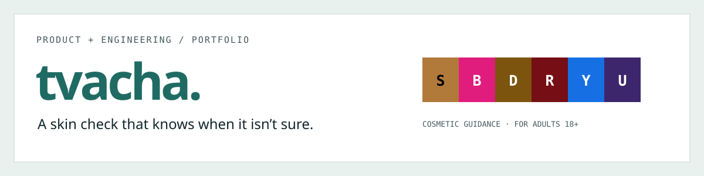
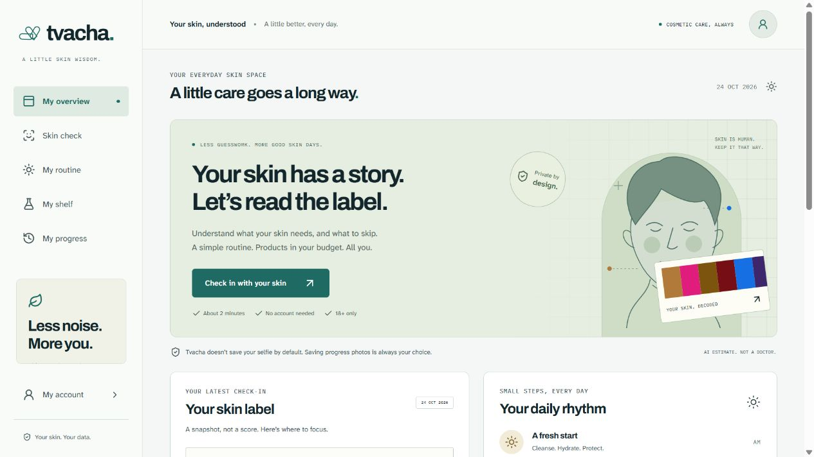
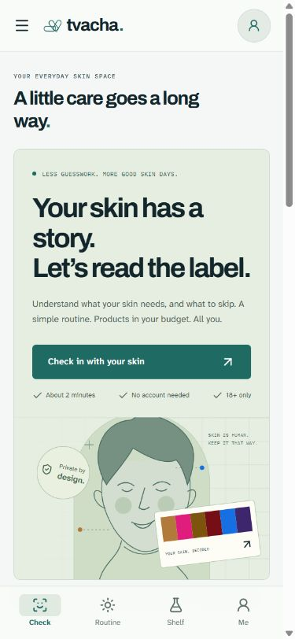
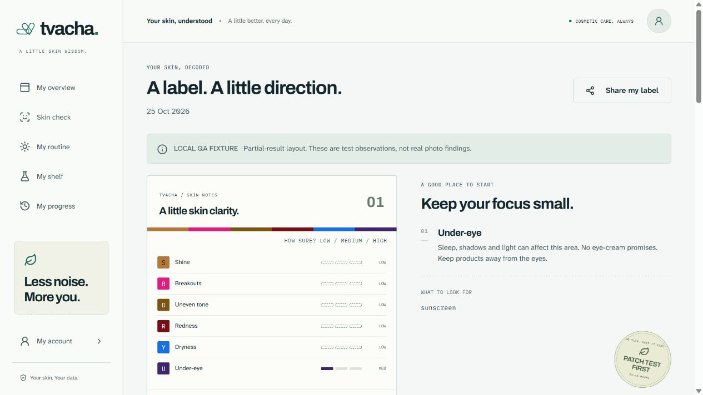
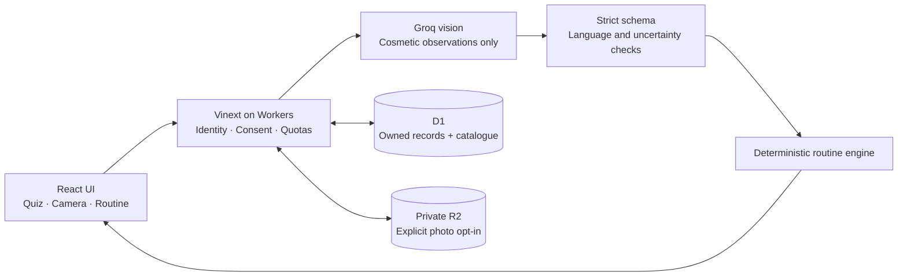

<p align="center"></p>

# Tvacha · Skin Studio

[](https://github.com/akhil-itpro/tvacha-skin-studio/actions/workflows/verify.yml)


**Cosmetic skincare guidance that combines uncertain photo observations with practical, budget-aware routines.** Built for adults in India, Tvacha helps people choose fewer suitable products, use what they already own, and build a consistent routine. AI observes visible detail; deterministic code chooses the products.

[Reviewer tour](docs/DEMO.md) · [Product case study](docs/CASE_STUDY.md) · [Business value](docs/BUSINESS_VALUE.md) · [Architecture](docs/ARCHITECTURE.md) · [Run locally](docs/SETUP.md) · [API](docs/API.md) · [Test evidence](docs/TESTING.md)

## Why this project exists

Skincare discovery often ends in a long shopping list, unclear recommendations, and products outside the buyer’s budget. A photo also has limits: poor light, compression, and camera quality can hide detail. Tvacha addresses both problems with a short preference quiz, an optional photo check, explicit confidence, and a small routine selected from a controlled catalogue.

This is a working full-stack portfolio project with persistent data, account boundaries, private photo storage, founder tools, and tested failure paths. It provides cosmetic guidance, not diagnosis or treatment.

## See the product



<details>
<summary>Mobile view and partial-result example</summary>





The partial-result screenshot is explicitly labelled a **local test fixture**. Its observations demonstrate UI behavior and are not a real person’s findings. Screenshots contain no visitor selfies or account details.

</details>

**Hosted pilot:** [Open Tvacha](https://tvacha-skin-studio.sunnyrain129.chatgpt.site/). The hosted Site currently restricts access; it is not an anonymous public demo. The source, screenshots, and local quiz experience can be reviewed without access to its production account or AI keys.

## What works

| Capability | Behavior |
| --- | --- |
| Skin check | 18+ confirmation, separate consent, four preference questions, symptom stop, front camera and upload |
| Photo analysis | Optional local framing, primary-face assessment, per-concern confidence, explicit unreadable values, bounded retry and quiz fallback |
| Product selection | 24 real catalogue entries, three ₹ budgets, shelf reuse, sensitivity restrictions, sunscreen, one new active and cheaper eligible alternatives |
| Everyday use | Persistent AM/PM ticks, seven-day view, streak, product shelf, saved labels and uncertainty-aware comparisons |
| Personal data | Guest-to-account migration, private opt-in progress photos, individual photo deletion, consent withdrawal, JSON export and account-data deletion |
| Founder tools | Server-checked admin access, real event aggregates, scan caps, catalogue editor, support details and referral/waitlist insights |
| Sharing and install | Face-free PNG share/download, opaque invites, join/leave Pro waitlist, install assets and an offline page that excludes personal data |

**Deliberate boundaries:** no payments, no fabricated reviews or conversion numbers, no claims of clinical accuracy, and no secret in browser code. Pro is a waitlist. Privacy and Terms are marked DRAFT pending operator/legal review.

## How it adds business value

- **For consumers:** budget filters and shelf reuse reduce unnecessary product suggestions; a short routine reduces decision overload.
- **For a retailer or affiliate partner:** product links follow stated needs and preferences, with disclosure and no paid ranking. Purchase conversion is not currently measured.
- **For the operator:** funnel events, retention cohorts, and price preferences support product decisions; server quotas bound photo attempts and provider usage.
- **For a team evaluating the project:** the code demonstrates AI integration, product rules, edge deployment, data ownership, concurrency safeguards, and operational tradeoffs in one coherent system.

These are value propositions, not proven commercial outcomes. [Business value](docs/BUSINESS_VALUE.md) defines the hypotheses, measurement plan, illustrative economics, and rollout gates.

## Architecture at a glance



**Stack:** React 19, TypeScript, Vinext/Vite, Cloudflare Workers, D1/SQLite, R2, Drizzle migrations, Zod, MediaPipe and Groq. Hosted authentication is supplied by Sites through Sign in with ChatGPT. Local development uses an explicitly scoped mock identity. See [architecture](docs/ARCHITECTURE.md) and [data/privacy](docs/DATA_AND_PRIVACY.md).

## Run it locally

Node.js **24** and npm are recommended. No AI key is required for quiz routines.

```sh
git clone https://github.com/akhil-itpro/tvacha-skin-studio.git
cd tvacha-skin-studio
npm run install:ci
npm run build
```

Apply the three database migrations to a **fresh local database**, as shown in [setup](docs/SETUP.md#initialize-a-fresh-local-database), then start:

```sh
npm run dev
```

Open `http://127.0.0.1:5173`. [Setup](docs/SETUP.md) includes Windows instructions, local sign-in, optional AI configuration and troubleshooting. Production authentication depends on the hosting platform; a raw Worker deployment needs its own trusted authentication boundary.

## Verification

```sh
npm run docs:check
npm run typecheck
npm test
npm run build
```

The current regression suite has **69 unit/domain/server checks** and **7 HTTP integration checks**. The GitHub workflow exercises both suites, a fresh local database, documentation links, and the production build. Live provider checks used clear and degraded public test portraits; they establish behavior, not cosmetic accuracy. [Testing](docs/TESTING.md) records what is and is not verified.

## Explore the repository

| Area | Start here |
| --- | --- |
| Guided product/code tour | [Reviewer walkthrough](docs/DEMO.md) |
| Product reasoning and engineering story | [Case study](docs/CASE_STUDY.md) |
| Customer value, metrics and economics | [Business value](docs/BUSINESS_VALUE.md) |
| Components, data flow and design decisions | [Architecture](docs/ARCHITECTURE.md) |
| Install, configuration and local database | [Setup](docs/SETUP.md) |
| Request/response contracts | [API reference](docs/API.md) |
| Ownership, consent and deletion | [Data and privacy](docs/DATA_AND_PRIVACY.md) |
| Regression evidence and CI | [Testing](docs/TESTING.md) |
| Deployment and support | [Operations](docs/OPERATIONS.md) |
| Remaining work and acceptance gates | [Roadmap](docs/ROADMAP.md) |
| Contributing and reporting vulnerabilities | [Contributing](CONTRIBUTING.md), [Security](SECURITY.md) |
| Detailed implementation/release records | [Backend](BACKEND.md), [Completion](COMPLETION.md), [Release notes](RELEASE_NOTES.md) |

## Authorship and licenses

Portfolio owner: [Akhil Codes](https://github.com/akhil-itpro). The project was developed iteratively with AI coding assistance from a supplied product brief. The case study describes the decisions and verification performed, without presenting the AI model as clinically validated.

A project-wide open-source license has not been selected. Bundled starter code, UI assets and fonts retain their original licenses; see [third-party notices](THIRD_PARTY_NOTICES.md). Public source access does not imply a medical certification, an affiliate agreement, or permission to use the production infrastructure.
