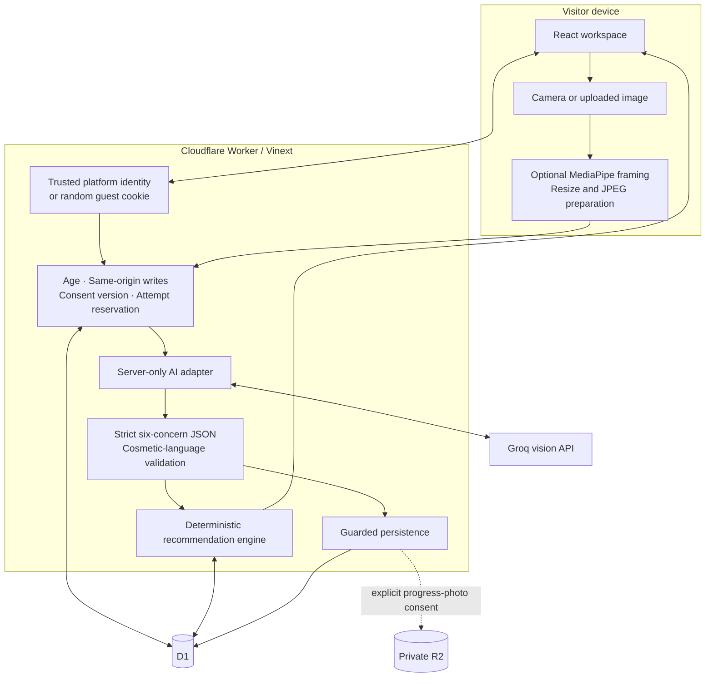

# Architecture and engineering decisions

[Back to README](../README.md)

## System boundaries



The browser supplies preferences and image data, not an authoritative user ID, admin role, quota, price or product ranking. MediaPipe is a convenience for framing; it does not authorize analysis or certify image quality.

## Application structure

| Directory | Responsibility |
| --- | --- |
| `app/components/` | Overview, check flow, camera, result, routine, shelf, progress and founder screens |
| `app/api/[...path]/route.ts` | Next-style route entry into the server handler |
| `src/domain/` | Shared contracts, catalogue, cosmetic validation, recommendation and comparison rules |
| `src/client/` | Typed requests, cancellable API helper, pagination, photo preparation and PNG sharing |
| `src/server/` | Request validation, identity, consent, quotas, provider calls and owned data operations |
| `db/`, `drizzle/` | Drizzle schema and three tracked SQLite migrations |
| `worker/` | Worker fetch entry and request-scoped platform integration |
| `scripts/` | Portable build/install tooling, verification and controlled provider probes |
| `public/` | Icons, manifest, generic offline page, self-hosted fonts and their licenses |

Vinext runs the React/Next-style app model on Workers through Vite. D1 holds durable records. R2 stores only explicitly saved progress photos. There is no client-accessible database binding.

## Photo contract

Six cosmetic concerns are returned: `shine`, `breakouts`, `dark_spots`, `redness`, `dryness`, and `under_eye`.

```json
{
  "key": "dryness",
  "level": null,
  "confidence": "low",
  "zones": [],
  "note": "Soft focus hides the detail in this area."
}
```

A numeric level is 0–3. A readable zero and an unreadable null are different. Null requires low confidence and no inferred zones. The app rejects malformed, duplicate, out-of-range or prohibited-language results. Notes and provider responses are bounded.

The model observes the primary foreground face. A photo can be accepted even when every concern is unreadable. If no usable subject exists, the app completes with a clearly labelled quiz routine. Failed validation can retry once; a quality-related rejection can receive one bounded review. The total provider deadline is 14 seconds, with at most two attempts. A failed review does not erase an earlier valid assessment.

## Recommendation pipeline

1. Stop the routine and product flow for a declared symptom red flag.
2. Choose up to three photo focus areas from medium/high-confidence positive observations; break ties using the stated concern. Quiz-only routines use the stated concern.
3. Map focus areas to the stored ingredient rules.
4. Filter the active catalogue by budget, skin-feel preference, fragrance and pregnancy cautions, sunscreen SPF and restricted ingredients.
5. Reuse suitable owned shelf items and prevent an additional new active when an active is already owned.
6. Rank eligible products by fit, with deterministic price/ID tie-breaks. Commission and click history are absent from ranking.
7. Offer only cheaper eligible alternatives for the same step.

The AM routine has at most four steps; PM has at most three. Sunscreen remains a step even if no safe catalogue product fits the budget. The app explains the gap instead of filling it with an unsuitable item.

## Consent and deletion during long requests

```mermaid
sequenceDiagram
    participant B as Browser
    participant W as Worker
    participant D as D1
    participant A as AI provider
    B->>W: Analyse photo + preferences
    W->>D: Read original profile generation and analysis consent
    W->>D: Atomically reserve attempt
    W->>A: In-memory JPEG
    A-->>W: Cosmetic observations
    W->>W: Validate response
    W->>D: Guarded insert: same profile and exact consent still exist
    alt Unchanged permission
        D-->>W: Saved scan and related events
        W-->>B: Label and routine
    else Deleted or changed consent
        D-->>W: No write
        W-->>B: Conflict; discard stale result
    end
```

Saving progress photos has a separate post-upload permission check. If permission changed during the R2 write, the object is removed. Account deletion first closes the profile, then removes stored objects and owned rows. A stale mutation cannot recreate data in a deleted or newly recreated profile.

## Identity and hosting dependency

Hosted sign-in uses Sites-supplied trusted `oai-authenticated-*` headers through `app/chatgpt-auth.ts`. Local development uses a loopback-only mock identity. Guests receive a random HttpOnly cookie and their data can migrate to a signed-in account.

**A raw Worker deployment must not trust client-provided identity headers.** Outside the Sites gateway, implement and validate a trusted authentication boundary and strip incoming identity headers before adapting `getChatGPTUser`. Copying the Worker to an unprotected endpoint is not a supported production auth setup.

D1 does not implement PostgreSQL RLS. Every private query is scoped by server identity; founder APIs check a server role or exact trusted allowlist. See [data/privacy](DATA_AND_PRIVACY.md).

## Operational tradeoffs

- UTC quota days are separate from India-local routine dates.
- The guest cookie is convenient, but clearing it creates a new guest identity; the global cap remains the cost guardrail.
- History uses stable timestamp/ID cursor pages rather than offsets or a fixed 200-record ceiling.
- The provider-retention flag records an operator assertion; it cannot observe a later console setting change.
- The service worker caches only the generic offline page and public icon, never private HTML, APIs or photos.
- Current tests address logic and failure paths. Real-device usability, visual-model accuracy and deployed two-account acceptance remain separate evidence requirements.
